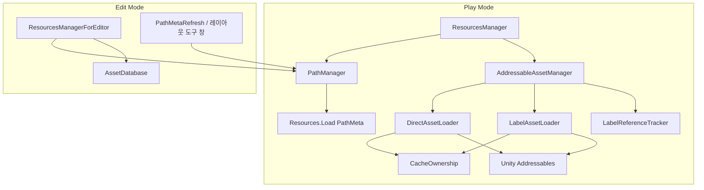

# Architecture: AddressableLayout

## 개요 (Overview)

*파일명 Lookup·라벨 preload·Play 동기 Addressables hit-only를 한 Resource 층으로 묶어, 타이틀이 typed 도메인 파사드 없이 Resources → Addressables 이관을 할 수 있게 한다.*

Addressable Layout은 Treasure/Core식 **Resource 층**만 UPM 패키지(`com.monet5379.addressable-layout`)로 분리한다. 게임 코드는 파일명·라벨·PathMeta Lookup으로 에셋에 닿고, `SpawnStage`·Json Facade 같은 typed API는 타이틀에 둔다.

**계약(불변조건) 정본**은 [루트 README](../../README.md)이다. 이 문서는 구조·호출 관계만 다룬다. Resource 층 용어·0.3.0 label load group 결정: [CONTEXT.md](../../CONTEXT.md) · [ADR 0001](../adr/0001-label-load-group-cache-ownership.md).

형제 Architecture:

| 문서 | 주제 |
| --- | --- |
| [Architecture_BootFlow](Architecture_BootFlow.md) | PathMeta → preload → gameplay sync |
| [Architecture_Lookup](Architecture_Lookup.md) | PathMeta · 이중 스캔 · 이관 |
| [Architecture_RuntimeEditor](Architecture_RuntimeEditor.md) | Play 캐시 vs `*ForEditor` |

## 책임과 경계 (Responsibilities & Boundaries)

*패키지 Runtime/Editor asmdef와 Demo Sample 경계를 구분하고, 타이틀 책임을 밖으로 넘긴다.*

### 포함 범위 (In Scope)

- `PathManager` / PathMeta Lookup · `AddressableAssetManager` 캐시 · `ResourcesManager` Play 파사드
- Editor: 레이아웃 도구 창 · `ResourcesManagerForEditor`
- Sample `Demo` — Play/Edit 검증 놀이터 (출시 복사 대상 아님)

### 제외 범위 (Out of Scope)

- typed 게임 파사드, Json/SO 파싱 Facade, Sheets Sync, Remote CDN 운영 전체
- 씬 전환·Release/Preload 정책 전체, 풀링 provider 강제, 일괄 마이그레이터
- 상세: [루트 README — 이 패키지가 아닌 것](../../README.md)

## 주요 타입과 관계 (Key Types & Relationships)

*Lookup → 로드 파사드 → Addressables/Resources 분기 구조를 타입 표와 의존 방향으로 정리한다.*

| 트리 | asmdef | 역할 |
| --- | --- | --- |
| `Packages/.../Runtime/` | `AddressableLayout.Runtime` | Play: Lookup · Addressables 캐시 · `ResourcesManager` |
| `Packages/.../Editor/` | `AddressableLayout.Editor` | PathMeta 갱신 · 레이아웃 도구 창 · `*ForEditor` |
| `Samples~/Demo/` | Demo asmdef | Demo 검증 — **출시 복사 대상 아님** |
| `Tests/Editor/` · `Tests/PlayMode/` | EditorTests · PlayModeTests | `CacheOwnershipTests` · `DemoPlayModeTests` |

| 타입 | 레이어 | 책임 |
| --- | --- | --- |
| `PathManager` | Lookup | `PathMetaData.json` 로드 · 파일명 → path · `IsAddressablePath` · (Editor) 디스크 스캔 갱신 |
| `AddressableAssetManager` | Addressables | Play Addressables **공개 파사드** — Direct/라벨 로더·ref-tracker 조합 · acquire/`ReleaseLabel` 오케스트레이션 · `LoadLabel` / `CountLabelLocations` |
| `DirectAssetLoader` | Addressables (internal) | Direct 경로: location resolve · PrimaryKey in-flight `Task` · `_directHandles` · `ReleaseAll` generation |
| `LabelAssetLoader` | Addressables (internal) | 라벨 bulk `(label, typeof(T))` handle · in-flight `Task` · label owner로 `CacheOwnership` 적재 · ref 0 evict |
| `LabelReferenceTracker` | Addressables (internal) | 라벨 문자열 ref-count · asset count (`CopyLoadedLabels`) · 실패 시 rollback |
| `CacheOwnership` | Addressables (internal) | PrimaryKey·alias 조회 · owner-set — **객체**만 보관; Addressables handle은 Direct/Label 로더가 소유 |
| `AddressableLabelLoadByType` | Play (internal) | `LoadRequest.AssetType` → 제네릭 `CountLabelLocations` / `LoadLabel` (expression tree 바인딩) |
| `AddressableLabelGroupRunner` | Play (internal) | DDOL `MonoBehaviour` — async load group coroutine 호스트 |
| `AddressableLogging` | Addressables (internal) | preload empty · settings.json / Invalid path 오류 메시지 |
| `AddressableLabels` | 계약 | 종류(`boot`, `JSON`, …) · Demo place 상수 |
| `AddressableLabelGroupManager` | Play (load group) | `LoadRequest.Id` + 라벨 목록 sync/async · `KeepResident` / `force` Release |
| `LoadRequest` / `LoadOperation` / `LabelLoadMode` | Play (load group) | 그룹 요청 · `CustomYieldInstruction` 진행률 · sync/async |
| `IPrefabInstanceProvider` | Play (호스트) | `SpawnPrefab` / `Despawn` 인스턴스 생성·반환 — 기본 Instantiate/Destroy |
| `ResourcesManager` | Play 파사드 | Path 분기 · sync hit-only · `PreloadTypeLabels` · Spawn/Despawn (provider 경유) · place enter/leave |
| `ResourcesManagerForEditor` | Edit 파사드 | AssetDatabase / settings 라벨 — **Play 캐시 미사용** |
| `StringKeyedMap` | 직렬화 | JsonUtility용 filename→path 맵 |

게임 부트는 보통 **`ResourcesManager`만** 바깥에 노출하고, `AddressableAssetManager`는 `ResourcesManager.AssetManager`로 필요할 때만 접근한다.

- **PathManager**는 Play에서 JSON만 읽는다. 디스크 스캔(`UpdatePathMetadata`)은 Editor 메뉴·윈도우가 호출한다.
- **AddressableAssetManager**는 `ResourcesManager`의 private static 인스턴스 하나로 묶인다. 구현은 `Runtime/Resource/Addressable/` 단일 asmdef 트리 안에서 **로더 분리**(`DirectAssetLoader` · `LabelAssetLoader` · `LabelReferenceTracker`) + `CacheOwnership` 공유다.

**Play 캐시·핸들 (Addressable 모듈)**

| 구성요소 | 상태 | 키 | 용도 |
| --- | --- | --- | --- |
| `CacheOwnership` | `_cache` | PrimaryKey · alias → PrimaryKey · owner → PrimaryKey | 적재 객체·owner-set; 마지막 owner 제거 시 entry evict |
| `DirectAssetLoader` | `_directHandles` | PrimaryKey | `LoadResourceAsync` Direct owner용 `Addressables.Release` handle |
| `DirectAssetLoader` | `_loadingTasks` | PrimaryKey | Direct in-flight `Task` — 동일 PrimaryKey 동시 요청 공유 |
| `DirectAssetLoader` | `_generation` | (스칼라) | `ReleaseAll` 이후 stale Direct 완료가 캐시에 재진입하지 않도록 |
| `LabelAssetLoader` | `_labelHandles` | `(label, Type)` | bulk `LoadAssetsAsync` — 동일 라벨·타입 in-flight·완료 handle 공유 |
| `LabelAssetLoader` | `_labelInflightLoads` | `(label, Type)` | async 라벨 bulk in-flight `Task` — sync·async·`PreloadLabel*` 공유 |
| `LabelAssetLoader` | `_generation` | (스칼라) | `ReleaseAll` 이후 stale label bulk 완료 차단 |
| `LabelReferenceTracker` | ref / asset count | 라벨 문자열 | load·preload **호출마다** acquire(ref++); `CopyLoadedLabels`용 asset count |

**소유 규칙:** `LoadResourceAsync`는 Direct owner, `LoadResourcesByLabelAsync`·label preload는 라벨 문자열 owner, 동기 `LoadResource`는 캐시 hit만(소유 없음). 캐시 hit이어도 Direct owner가 없으면 async 경로로 Direct handle을 확보한다. `Release(key)`는 Direct owner만 제거하고 `DirectAssetLoader`가 `_directHandles`를 해제한다. **`ReleaseLabel` / `ReleaseLabelRef`(obsolete)** 는 `LabelReferenceTracker` ref-count를 1 감소하고, **ref가 0일 때만** `LabelAssetLoader.Evict`로 해당 라벨의 `(label, Type)` handle을 해제하고 `CacheOwnership.ReleaseOwner(label)`한다. ref에 없는 라벨에 대한 `ReleaseLabel`은 no-op(v0.2 즉시 evict와 다름 — preload acquire 경로만 해제 대상). 개별 Direct handle은 `ReleaseLabel`이 건드리지 않는다. 두 라벨이 같은 PrimaryKey를 공유하면 owner가 남는 동안 sync hit은 유지된다.

`DirectAssetLoader.LoadResourceAsync`는 location resolve 후 Direct owner hit이면 즉시 반환하고, 아니면 `_loadingTasks` `Task`를 공유한다. 완료·실패 후 해당 PrimaryKey 항목을 제거한다. 요청 주소·InternalId alias는 await 이후 `CacheOwnership`에 등록한다. 라벨 경로는 `AddressableAssetManager`가 캐시 hit 시 `LabelReferenceTracker.Acquire`만 하고, miss 시 acquire 후 `LabelAssetLoader` bulk load — `(label, typeof(T))` in-flight `Task` 공유, 실패 시 acquire rollback. sync 그룹·`LabelLoadMode.Sync`는 `AddressableAssetManager.RunSynchronously`로 coroutine을 프레임 yield 없이 실행한다( yield 시 중단·로그). async load group은 `AddressableLabelGroupRunner` coroutine으로 돌린다.

**Play API 표면 (대표)**

| 메서드 | Addressables path (`Assets/...`) | Resources leaf |
| --- | --- | --- |
| `LoadResource` | 캐시 hit만 → miss면 `null` | `Resources.Load` |
| `LoadResourceAsync` | Addressables 로드 + 캐시 (동일 PrimaryKey 동시 요청은 진행 중 Task 공유) | `Resources.Load` (Task로 반환) |
| `LoadResourcesByLabelAsync` | 라벨 일괄 + 캐시 | (해당 없음) |
| `LoadResourceByName` | Lookup 후 위 규칙 | 동일 |
| `SpawnPrefab` | preload 후 sync hit → provider Spawn | leaf면 즉시 Load 가능 |

`EnterPlaceAsync` / `LeavePlace`는 place 라벨 preload / `ReleaseLabel` 래퍼이다.

**Host parity (0.3.0 ship)** — Dragon `TSResourcesManager`가 기대하는 공개 표면 prose 정리는 [패키지 README — Host parity](../../project/unity-addressable/Packages/com.monet5379.addressable-layout/README.md#host-parity-dragon-tsresourcesmanager-기대-표면)가 정본이다. Architecture는 캐시·owner 의미만 다룬다.

## 흐름 (Flow)

*Play·Editor에서 Resource 층을 거치는 대표 경로만 적는다. 부트·Lookup·Editor 상세는 형제 Architecture를 본다.*

### 런타임 흐름 (Runtime Flow)

1. `PathManager.Load()` — PathMeta → 메모리 Lookup ([Architecture_BootFlow](Architecture_BootFlow.md))
2. (선택) 종류·place 라벨 preload — `LoadResourcesByLabelAsync` / `PreloadTypeLabels` / `AddressableLabelGroupManager.LoadGroup` / `EnterPlaceAsync`
3. `LoadResourceByName` / `LoadResource` / `SpawnPrefab` — path 종류에 따라 Resources vs 캐시 hit-only ([Architecture_Lookup](Architecture_Lookup.md))

### 에디터 흐름 (Editor Flow)

1. **레이아웃 도구** → 갱신 — PathMeta JSON ([Architecture_Lookup](Architecture_Lookup.md))
2. Edit Mode 툴 — `ResourcesManagerForEditor` ([Architecture_RuntimeEditor](Architecture_RuntimeEditor.md))

## 불변조건과 주의점 (Invariants & Gotchas)

*README 계약 중 구조와 직결된 항목만 요약한다. 전문은 README가 이긴다.*

- 파일명 전역 키 · `Assets/Addressables/` 단일 콘텐츠 루트 · 종류 라벨 ≠ place 라벨
- Play Addressables 경로: **동기 `LoadResource` = 캐시 hit만** — miss는 null
- **동일 PrimaryKey `LoadResourceAsync` 동시 호출** — in-flight Task 공유; Direct handle은 PrimaryKey당 하나
- **라벨 preload와 Direct가 같은 PrimaryKey 공유** — owner-set; 한쪽만 `Release`/`ReleaseLabel`해도 다른 owner가 남으면 sync hit 유지
- Edit `*ForEditor`는 Play 캐시를 채우지 않는다
- Demo Sample ≠ 출시 카탈로그

## 변경 가이드 (Change Guidelines)

*패키지 경계·공개 Play API를 바꿀 때 확인한다.*

| 변경 | 확인 |
| --- | --- |
| Play 로드·캐시 규칙 | `ResourcesManager`, `AddressableAssetManager`, `DirectAssetLoader`, `LabelAssetLoader`, `LabelReferenceTracker` |
| Lookup·스캔 | `PathManager`, `PathMetaRefresh` |
| Edit 레이아웃 도구 | `AddressableLayoutToolWindow` |
| 계약 문구 | [루트 README](../../README.md) 불변조건 먼저 |

- [x] README 불변조건과 동기화 (0.3.0 Host parity · label ref-count)
- [x] Addressable 모듈 로더 분리(`DirectAssetLoader` · `LabelAssetLoader` · `LabelReferenceTracker`) 반영 (2026-10-28)
- [x] `verify.ps1` Edit 15 / Play 6 · `CacheOwnershipTests` 확장 (2026-10-28)

## 관련 문서 (See also)

- [Architecture_BootFlow](Architecture_BootFlow.md)
- [Architecture_Lookup](Architecture_Lookup.md)
- [Architecture_RuntimeEditor](Architecture_RuntimeEditor.md)
- [루트 README](../../README.md)
