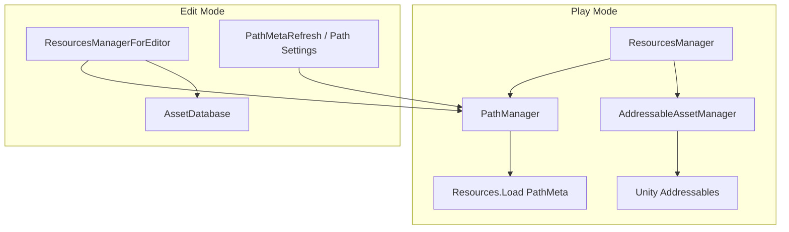

# Architecture: AddressableLayout

## 개요 (Overview)

*파일명 Lookup·라벨 preload·Play 동기 Addressables hit-only를 한 Resource 층으로 묶어, 타이틀이 typed 도메인 파사드 없이 Resources → Addressables 이관을 할 수 있게 한다.*

Addressable Layout은 Treasure/Core식 **Resource 층**만 UPM 패키지(`com.monet5379.addressable-layout`)로 분리한다. 게임 코드는 파일명·라벨·PathMeta Lookup으로 에셋에 닿고, `SpawnStage`·Json Facade 같은 typed API는 타이틀에 둔다.

**계약(불변조건) 정본**은 [루트 README](../../README.md)이다. 이 문서는 구조·호출 관계만 다룬다.

형제 Architecture:

| 문서 | 주제 |
| --- | --- |
| [Architecture_BootFlow](Architecture_BootFlow.md) | PathMeta → preload → gameplay sync |
| [Architecture_Lookup](Architecture_Lookup.md) | PathMeta · 이중 스캔 · 이관 |
| [Architecture_RuntimeEditor](Architecture_RuntimeEditor.md) | Play 캐시 vs `*ForEditor` |

## 책임과 경계 (Responsibilities & Boundaries)

*패키지 Runtime/Editor asmdef와 Demo Sample 경계를 구분하고, 타이틀 책임을 밖으로 넘긴다.*

### 포함 범위 (In Scope)

- `PathManager` / PathMeta Lookup · `AddressableAssetManager` 캐시 · `ResourcesManager` Play 파사드
- Editor: Path Settings · Refresh Paths · `ResourcesManagerForEditor`
- Sample `Demo` — Play/Edit 검증 놀이터 (출시 복사 대상 아님)

### 제외 범위 (Out of Scope)

- typed 게임 파사드, Json/SO 파싱 Facade, Sheets Sync, Remote CDN 운영 전체
- 씬 전환·Release/Preload 정책 전체, LeanPool 필수화, 일괄 마이그레이터
- 상세: [루트 README — 이 패키지가 아닌 것](../../README.md)

## 주요 타입과 관계 (Key Types & Relationships)

*Lookup → 로드 파사드 → Addressables/Resources 분기 구조를 타입 표와 의존 방향으로 정리한다.*

| 트리 | asmdef | 역할 |
| --- | --- | --- |
| `Packages/.../Runtime/` | `AddressableLayout.Runtime` | Play: Lookup · Addressables 캐시 · `ResourcesManager` |
| `Packages/.../Editor/` | `AddressableLayout.Editor` | PathMeta 갱신 · Path Settings · `*ForEditor` |
| `Samples~/Demo/` | Demo asmdef | Demo 검증 — **출시 복사 대상 아님** |

| 타입 | 레이어 | 책임 |
| --- | --- | --- |
| `PathManager` | Lookup | `PathMetaData.json` 로드 · 파일명 → path · `IsAddressablePath` · (Editor) 디스크 스캔 갱신 |
| `AddressableAssetManager` | Addressables | 비동기 로드 · Dictionary 캐시(PrimaryKey + alias) · 라벨 단위 릴리즈 |
| `AddressableLabels` | 계약 | 종류(`boot`, `JSON`, …) · Demo place 상수 |
| `ResourcesManager` | Play 파사드 | Path 분기 · sync hit-only · Spawn/Despawn · place enter/leave |
| `ResourcesManagerForEditor` | Edit 파사드 | AssetDatabase / settings 라벨 — **Play 캐시 미사용** |
| `StringKeyedMap` | 직렬화 | JsonUtility용 filename→path 맵 |

게임 부트는 보통 **`ResourcesManager`만** 바깥에 노출하고, `AddressableAssetManager`는 `ResourcesManager.AssetManager`로 필요할 때만 접근한다.

- **PathManager**는 Play에서 JSON만 읽는다. 디스크 스캔(`UpdatePathMetadata`)은 Editor 메뉴·윈도우가 호출한다.
- **AddressableAssetManager**는 `ResourcesManager`의 private static 인스턴스 하나로 묶인다.

**Play API 표면 (대표)**

| 메서드 | Addressables path (`Assets/...`) | Resources leaf |
| --- | --- | --- |
| `LoadResource` | 캐시 hit만 → miss면 `null` | `Resources.Load` |
| `LoadResourceAsync` | Addressables 로드 + 캐시 | `Resources.Load` (Task로 반환) |
| `LoadResourcesByLabelAsync` | 라벨 일괄 + 캐시 | (해당 없음) |
| `LoadResourceByName` | Lookup 후 위 규칙 | 동일 |
| `SpawnPrefab` | preload 후 sync hit 전제 | leaf면 즉시 Load 가능 |

`EnterPlaceAsync` / `LeavePlace`는 place 라벨 preload / `ReleaseLabel` 래퍼이다.

## 흐름 (Flow)

*Play·Editor에서 Resource 층을 거치는 대표 경로만 적는다. 부트·Lookup·Editor 상세는 형제 Architecture를 본다.*

### 런타임 흐름 (Runtime Flow)

1. `PathManager.Load()` — PathMeta → 메모리 Lookup ([Architecture_BootFlow](Architecture_BootFlow.md))
2. (선택) 종류·place 라벨 preload — `LoadResourcesByLabelAsync` / `EnterPlaceAsync`
3. `LoadResourceByName` / `LoadResource` / `SpawnPrefab` — path 종류에 따라 Resources vs 캐시 hit-only ([Architecture_Lookup](Architecture_Lookup.md))

### 에디터 흐름 (Editor Flow)

1. **Refresh Paths** / Path Settings — PathMeta JSON 갱신 ([Architecture_Lookup](Architecture_Lookup.md))
2. Edit Mode 툴 — `ResourcesManagerForEditor` ([Architecture_RuntimeEditor](Architecture_RuntimeEditor.md))

## 불변조건과 주의점 (Invariants & Gotchas)

*README 계약 중 구조와 직결된 항목만 요약한다. 전문은 README가 이긴다.*

- 파일명 전역 키 · `Assets/Addressables/` 단일 콘텐츠 루트 · 종류 라벨 ≠ place 라벨
- Play Addressables 경로: **동기 `LoadResource` = 캐시 hit만** — miss는 null
- Edit `*ForEditor`는 Play 캐시를 채우지 않는다
- Demo Sample ≠ 출시 카탈로그

## 변경 가이드 (Change Guidelines)

*패키지 경계·공개 Play API를 바꿀 때 확인한다.*

| 변경 | 확인 |
| --- | --- |
| Play 로드·캐시 규칙 | `ResourcesManager`, `AddressableAssetManager` |
| Lookup·스캔 | `PathManager`, `PathMetaRefresh` |
| Edit 스모크·메뉴 | `ForEditorSmokeMenu`, `PathSettingsWindow` |
| 계약 문구 | [루트 README](../../README.md) 불변조건 먼저 |

- [ ] README 불변조건과 동기화
- [ ] Demo Sample / Smoke ForEditor로 회귀 확인

## 관련 문서 (See also)

- [Architecture_BootFlow](Architecture_BootFlow.md)
- [Architecture_Lookup](Architecture_Lookup.md)
- [Architecture_RuntimeEditor](Architecture_RuntimeEditor.md)
- [루트 README](../../README.md)
