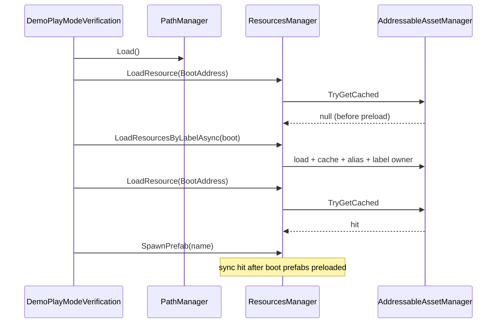

# Architecture: BootFlow

## 개요 (Overview)

*Play Mode에서 PathMeta 로드 → 라벨 preload → gameplay sync hit-only까지의 권장 순서를 정의한다.*

Demo Sample의 `DemoPlayModeVerification`(Test Runner **Play Mode** `DemoPlayModeTests`; 수동 Play는 `DemoAddressableHost`)이 같은 순서를 검증한다. 계약 정본은 [루트 README](../../README.md)이다.

## 책임과 경계 (Responsibilities & Boundaries)

*부트·place 입퇴장·릴리즈 순서만 소유한다. Lookup 규칙·Editor 파사드는 형제 Architecture로 넘긴다.*

### 포함 범위 (In Scope)

- `PathManager.Load()` 타이밍 · 종류(type) 라벨 preload · place `EnterPlaceAsync` / `LeavePlace`
- gameplay `LoadResource` / `SpawnPrefab` sync 전제 · `Release` / `ReleaseLabel` / `ReleaseAll`

### 제외 범위 (Out of Scope)

- PathMeta 스캔·중복 규칙 → [Architecture_Lookup](Architecture_Lookup.md)
- Edit Mode `*ForEditor` → [Architecture_RuntimeEditor](Architecture_RuntimeEditor.md)
- 씬 전환·Remote Release/Preload 정책 전체 (타이틀)

## 주요 타입과 관계 (Key Types & Relationships)

*부트 경로에서 호출하는 Play 타입만 적는다.*

| 타입 | 부트에서의 역할 |
| --- | --- |
| `PathManager` | `Load()` — JSON Lookup 준비 |
| `ResourcesManager` | 라벨 preload · sync load · Spawn · place enter/leave |
| `AddressableAssetManager` | preload 시 캐시·alias · `LoadResourceAsync` PrimaryKey in-flight 공유 · sync hit-only 근거 |
| `AddressableLabels` | `boot`, `JSON`, … 및 Demo place 상수 |

## 흐름 (Flow)

*권장 Play 초기화·게임플레이·정리 순서이다.*

### 런타임 흐름 (Runtime Flow)

```text
1. PathManager.Load()           ← PathMetaData.json → 메모리 Lookup
2. (선택) 종류 라벨 preload      ← boot, JSON, Scriptable, ui, …
3. (선택) 지역 입장 시 place preload ← EnterPlaceAsync
4. 게임플레이                    ← LoadResource (sync), SpawnPrefab, …
5. 퇴장 / 종료                   ← LeavePlace, ReleaseLabel, ReleaseAll
```

**1. PathMeta** — `PathManager.Load()`가 `Resources.Load<TextAsset>("Data/PathMetaData")`로 JSON을 읽는다. JSON은 Editor **레이아웃 도구** → 갱신으로 생성·갱신한다. `Lookup`이 lazy `Load()`를 부를 수 있으나, 부트에서 **명시적으로 한 번** 호출하는 편이 안전하다.

**2. 종류 라벨 preload** — `LoadResourcesByLabelAsync<T>(AddressableLabels.Boot)` 등. 로더는 PrimaryKey와 PathMeta 주소 **alias**를 캐시에 넣어 sync hit-only가 동작하게 한다. 부트와 겹치는 단일 에셋을 `LoadResourceAsync`로 동시에 당겨도 PrimaryKey 기준 in-flight Task가 합쳐진다.

**3. place 라벨** — `EnterPlaceAsync` (= 라벨 preload), gameplay, `LeavePlace` (= `ReleaseLabel`). 입장 전 Addressables sync는 miss(null), 입장 후 hit, 퇴장 후 다시 miss.

**4. gameplay** — `LoadResourceByName` / `LoadResource` / `SpawnPrefab`. Addressables path sync miss는 의도된 결과이다. Resources leaf는 `Resources.Load`가 sync에서 바로 동작한다.

**5. 릴리즈** — `Release` / `LeavePlace` / `ReleaseAll`. 씬 전환 정책은 타이틀 책임이다.

### 런타임 흐름 — Demo preload (Runtime Flow)



## 불변조건과 주의점 (Invariants & Gotchas)

*부트 순서를 어기면 sync null·누수·잘못된 hit 기대가 난다.*

- **Lookup 전 `PathManager.Load()`** (또는 첫 Lookup 전 보장)
- Addressables 경로: gameplay sync는 **preload 범위 안에서만** hit 기대
- **같은 PrimaryKey `LoadResourceAsync` 병렬** — 한 번의 Addressables load + 공유 Task; preload 완료 전 sync는 여전히 miss(null)
- `EnterPlaceAsync` 완료 전 place 에셋 sync load → null
- 라벨 preload 실패 시: Addressable Groups 라벨 · Play Mode Script(Fast Mode) · Demo **부트 샘플 등록**

Play 확인: Demo import → **부트 샘플 등록** → Test Runner **Play Mode** `DemoPlayModeTests`. Edit: **ForEditor 스모크** ([Architecture_RuntimeEditor](Architecture_RuntimeEditor.md)).

## 변경 가이드 (Change Guidelines)

| 변경 | 경로 |
| --- | --- |
| 부트 검증 | `DemoPlayModeVerification.cs` · `DemoPlayModeTests` · (수동 Play) `DemoAddressableHost` |
| 라벨 preload·place API | `ResourcesManager.cs` |
| 캐시·alias | `AddressableAssetManager.cs` |

- [ ] README 불변조건과 일치
- [ ] DemoPlayModeTests · ForEditor 스모크

## 관련 문서 (See also)

- [Architecture_AddressableLayout](Architecture_AddressableLayout.md)
- [Architecture_Lookup](Architecture_Lookup.md)
- [Architecture_RuntimeEditor](Architecture_RuntimeEditor.md)
- [루트 README](../../README.md)
