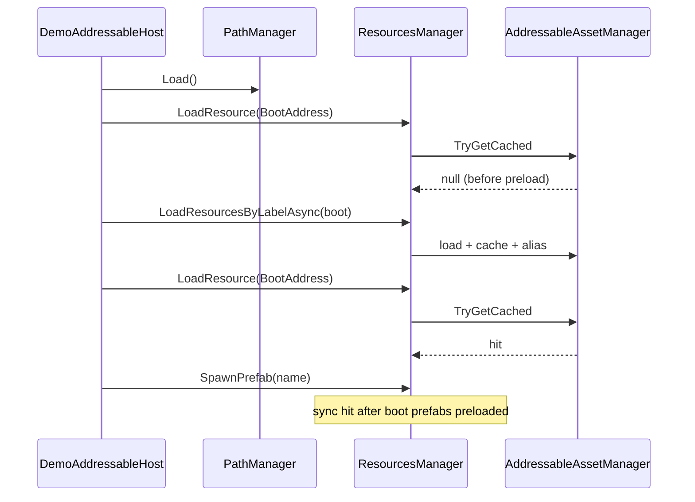

# 부트 흐름

Play Mode에서 Addressable Layout을 쓰는 **권장 순서**이다. Demo는 `DemoAddressableHost`가 같은 순서로 마일스톤을 검증한다.

## 권장 순서

```text
1. PathManager.Load()           ← PathMetaData.json → 메모리 Lookup
2. (선택) 종류 라벨 preload      ← boot, JSON, Scriptable, ui, …
3. (선택) 지역 입장 시 place preload ← EnterPlaceAsync
4. 게임플레이                    ← LoadResource (sync), SpawnPrefab, …
5. 퇴장 / 종료                   ← LeavePlace, ReleaseLabel, ReleaseAll
```

불변조건: **Lookup 전에 `PathManager.Load()`** — [README](../../README.md).

## 단계별 동작

### 1. PathMeta 로드

- `PathManager.Load()`가 `Resources.Load<TextAsset>("Data/PathMetaData")`로 JSON을 읽는다.
- 파일은 Editor에서 **Tools → Addressable Layout → Refresh Paths** (또는 Path Settings)로 생성·갱신된다.
- `Lookup`은 lazy하게 `Load()`를 부를 수 있지만, 부트에서 **명시적으로 한 번** 호출하는 편이 안전하다.

### 2. 종류(type) 라벨 preload

부트에 필요한 공유 에셋은 **종류 라벨**로 한 번에 올린다.

```csharp
await ResourcesManager.LoadResourcesByLabelAsync<ScriptableObject>(AddressableLabels.Boot);
// 타입·라벨은 프로젝트에 맞게
```

- `AddressableAssetManager`가 에셋을 로드하고 **PrimaryKey(GUID 등)** 로 캐시한다.
- PathMeta 주소(`Assets/...`)와 PrimaryKey가 다를 수 있어, 로더는 **alias**도 캐시에 넣어 sync hit-only가 동작하게 한다.

### 3. 지역(place) 라벨 — 입장 / 퇴장

지역 전용 콘텐츠는 **boot에 섞지 않고** place 라벨로 나눈다.

```csharp
await ResourcesManager.EnterPlaceAsync<T>(placeLabel);  // = LoadResourcesByLabelAsync
// … gameplay sync LoadResource / SpawnPrefab …
ResourcesManager.LeavePlace(placeLabel);                 // = ReleaseLabel
```

- 입장 전: 해당 Addressables 주소에 대한 `LoadResource` → **null** (캐시 miss).
- 입장 후: preload된 인스턴스로 sync hit.
- 퇴장 후: `ReleaseLabel`로 라벨에 묶인 핸들·캐시 키 정리 → 다시 miss.

Demo place 상수: `AddressableLabels.DemoAreaA` / `DemoAreaB` (타이틀은 `AreaNames` 같은 자체 id 사용).

### 4. 게임플레이 로드

| 필요 | API |
| --- | --- |
| 파일명만 알 때 | `LoadResourceByName<T>("Foo.asset")` |
| PathMeta 값·주소를 알 때 | `LoadResource<T>(path)` 또는 `LoadResourceAsync` |
| 프리팹 인스턴스 | `SpawnPrefab("Foo")` — Addressables면 **preload 후** sync |

**Addressables 경로에서 sync miss는 의도된 결과**이다. miss를 막으려면 해당 에셋을 부트/place preload에 포함하거나 `LoadResourceAsync`를 쓴다.

Resources leaf(`Demo/Foo` 형태)는 이관 중 **`Resources.Load`가 sync에서 바로** 동작한다.

### 5. 릴리즈

| 범위 | API |
| --- | --- |
| 단일 키 | `Release(key)` |
| place / 라벨 묶음 | `LeavePlace(label)` / `ReleaseLabel(label)` |
| 전체 (Demo·테스트) | `ReleaseAll()` |

씬 전환·Remote 정책 전체는 패키지 밖(타이틀) 책임이다.

## 타임라인 (Demo C)



## Editor / Addressables 설정

Play에서 라벨 preload가 실패하면:

1. 에셋에 라벨이 붙었는지 (Addressable Groups)
2. **Play Mode Script** — 로컬 개발은 `Use Asset Database (Fast Mode)` 권장
3. Demo: **Tools → Addressable Layout → Demo → Register Boot Sample**

자세한 Verify 단계는 [milestones.md](../milestones.md) 각 마일스톤 Exit를 참고한다.

## 타이틀 부트 체크리스트

- [ ] `PathManager.Load()` (또는 첫 `Lookup` 전 보장)
- [ ] `boot` / `JSON` / … 종류 라벨 preload 완료 대기
- [ ] gameplay에서 Addressables sync는 preload 범위 안에서만 기대
- [ ] Area 입장 시 `EnterPlaceAsync`, 퇴장 시 `LeavePlace`
- [ ] 콘텐츠 추가·이동 후 **Refresh Paths**
