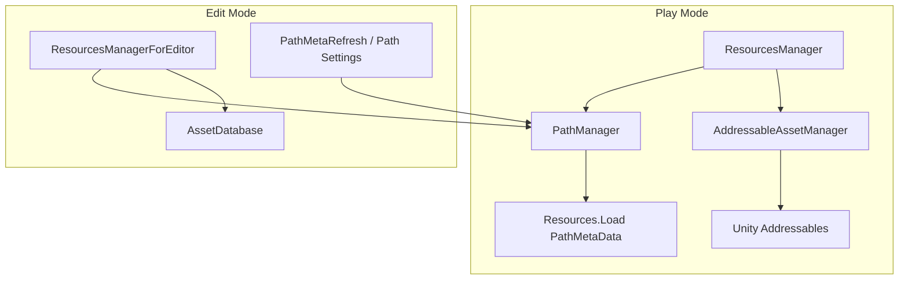

# 개요

Addressable Layout은 **Treasure/Core식 Resource 층**만 패키지로 분리한 Unity 라이브러리이다. 게임 코드는 파일명·라벨·PathMeta Lookup으로 에셋에 닿고, typed 도메인 파사드(`SpawnStage`, Json Facade 등)는 타이틀 쪽에 둔다.

**계약(불변조건)** 은 [루트 README](../../README.md)가 정본이다. 여기서는 **누가 무엇을 호출하는지**만 정리한다.

## 패키지 경계

| 트리 | asmdef | 역할 |
| --- | --- | --- |
| `Assets/AddressableLayout/Runtime` | `AddressableLayout.Runtime` | Play Mode: Lookup · Addressables 캐시 · `ResourcesManager` |
| `Assets/AddressableLayout/Editor` | `AddressableLayout.Editor` | PathMeta 갱신 · Path Settings · `*ForEditor` |
| `Assets/Demo` | Demo asmdef | 마일스톤 검증 놀이터 — **출시 복사 대상 아님** |

Runtime은 `Unity.Addressables` / `Unity.ResourceManager`만 참조한다. Editor는 Runtime + Addressables Editor API를 쓴다.

## 클래스 역할

| 타입 | 레이어 | 책임 |
| --- | --- | --- |
| `PathManager` | Lookup | `PathMetaData.json` 로드 · 파일명 → 경로 · `IsAddressablePath` · (Editor) 디스크 스캔으로 JSON 갱신 |
| `AddressableAssetManager` | Addressables | 비동기 로드 · Dictionary 캐시(PrimaryKey + alias) · 라벨 단위 릴리즈 |
| `AddressableLabels` | 계약 | 종류(`boot`, `JSON`, …) · Demo place 상수 |
| `ResourcesManager` | Play 파사드 | Path 분기(Resources leaf vs Addressables) · sync hit-only · Spawn/Despawn · place enter/leave |
| `ResourcesManagerForEditor` | Edit 파사드 | AssetDatabase / settings 라벨 — **Play 캐시 미사용** |
| `StringKeyedMap` | 직렬화 | JsonUtility용 filename→path 맵 |

게임 부트는 보통 **`ResourcesManager`만** 바깥에 노출하고, `AddressableAssetManager`는 `ResourcesManager.AssetManager`로 필요할 때만 접근하면 된다.

## 의존 방향

- **PathManager**는 Play에서 JSON만 읽는다. 디스크 스캔(`UpdatePathMetadata`)은 Editor 메뉴·윈도우가 호출한다.
- **AddressableAssetManager**는 `ResourcesManager`의 private static 인스턴스 하나로 묶여 있다.

## API 표면 (Play)

| 메서드 | Addressables 경로 (`Assets/...`) | Resources leaf |
| --- | --- | --- |
| `LoadResource` | 캐시 hit만 → miss면 `null` | `Resources.Load` |
| `LoadResourceAsync` | Addressables 로드 + 캐시 | `Resources.Load` (동기 결과를 Task로) |
| `LoadResourcesByLabelAsync` | 라벨 일괄 로드 + 캐시 | (해당 없음 — Addressables 전용) |
| `LoadResourceByName` | Lookup 후 위 규칙 적용 | 동일 |
| `SpawnPrefab` | preload 후 sync hit 전제 | Resources leaf면 즉시 Load 가능 |

`EnterPlaceAsync` / `LeavePlace`는 place 라벨에 대한 preload / `ReleaseLabel` 래퍼이다.

## 설계 의도 (짧게)

1. **파일명 전역 키** — 코드·데이터 시트는 `Foo.prefab` 이름만 알면 되고, 이관 시 경로 문자열만 PathMeta가 바꾼다.
2. **동기 = hit-only (Addressables)** — 메인 스레드에서 Addressables IO를 숨기지 않는다. 부트·지역 입장에서 라벨 preload로 캐시를 채운 뒤 gameplay sync를 쓴다.
3. **이중 스캔** — Resources → Addressables 순으로 PathMeta를 만들어, 파일 단위 이관 중에도 Lookup 하나로 유지한다.
4. **얇은 Spawn** — `SpawnPrefab(이름)`만 제공하고, 스테이지/몬스터/UI 라우팅은 타이틀 책임이다.

## 다음 문서

- [부트 흐름](boot-flow.md) — 권장 초기화 순서
- [Lookup · PathMeta](lookup.md) — 스캔 규칙과 경로 형태
- [Runtime / Editor](runtime-editor.md) — Play 캐시 vs `*ForEditor`
